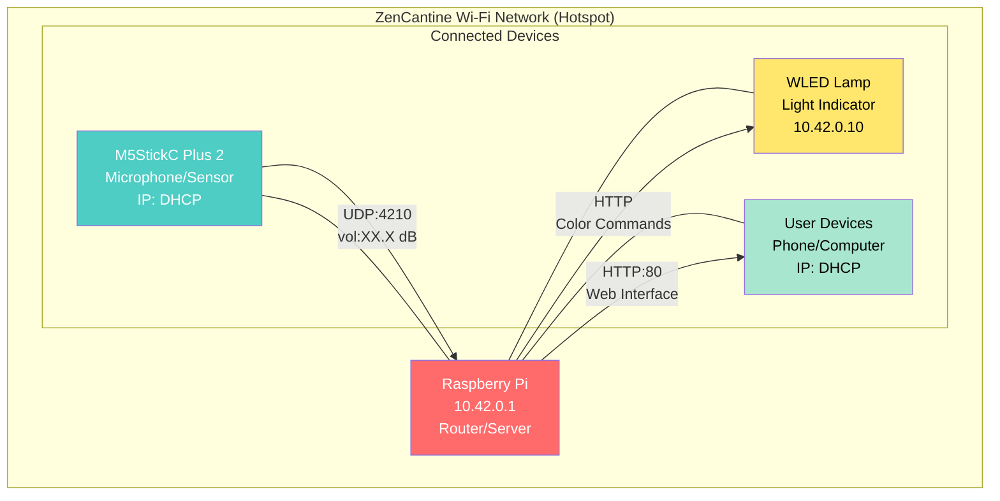

# 🤫 ZenCantine

Autonomous noise level monitoring system for school cafeterias.
The system displays a light alert (WLED Lamp) and visual (M5Stick) when noise exceeds a defined threshold.

## 📡 Network Architecture

The Raspberry Pi acts as an autonomous Wi-Fi router (Hotspot).

| Device | Role | Fixed IP | MAC Address |
|---|---|---|---|
| **Raspberry Pi** | Server / Router | `10.42.0.1` | N/A |
| **M5StickC Plus 2** | Micro / Sensor | DHCP | - |
| **WLED Lamp** | Light Indicator | `10.42.0.10` (default) | `TO CONFIGURE IN WLED` |

* **Wi-Fi SSID:** to define in `sensor_m5stick/config/config.h`
* **Password:** to define in `sensor_m5stick/config/config.h`

> 💡 **Tip:** Instead of using the IP `10.42.0.1`, you can access the Raspberry Pi via its hostname: `http://raspberrypi.local` (or the hostname you configured). This works on most local networks with mDNS.

**Legend:**
- 🔴 **Raspberry Pi**: Wi-Fi router, Flask server, SQLite database
- 🔵 **M5StickC Plus 2**: Audio sensor, sends UDP measurements
- 🟡 **WLED Lamp**: Light indicator controlled via HTTP
- 🟢 **User Devices**: Access to configuration web interface

## 🚀 Installation & Startup

The system is designed to start automatically when powered on.

### 1. Raspberry Pi (Server)
The main script is `server_raspberry/app.py`.
It listens for UDP packets from the M5Stick on `10.42.0.1:4210`, stores measurements in SQLite and controls a WLED lamp via HTTP.

> UDP is used only for transmitting the volume from the M5Stick sensor to the server.
> WLED lamp control is done via HTTP requests.

### 2. M5Stick (Micro)
The Arduino code uses the `M5Unified` library and sends volume via UDP on port `4210`.
The sound level is now measured in **dB SPL** (Sound Pressure Level).

### 3. WLED Lamp
The lamp must be accessible from the Raspberry Pi hotspot, ideally with a static IP or DHCP reservation.

## 🧩 Server Mode

This repository contains one active server:

- `server_raspberry/app.py`: Flask + dashboard version, stores measurements in SQLite and controls a WLED lamp via `server_raspberry/config/config.py`.

## 🌐 Web Interface

The Flask server provides a complete web interface accessible on the Raspberry Pi's IP (port 80).

### Features:
- **Real-time Dashboard**: Current volume display, alert status, daily statistics
- **Advanced Configuration**: Sound threshold settings (alert/reset), buffer size smoothing
- **Time Management**: Manual system time adjustment for offline systems
- **Data Visualization**: History charts for 1 hour or 24 hours
- **Administration**: Reset to default values, automatic parameter saving

### Access:
- URL: `http://10.42.0.1` or `http://raspberrypi.local` (or your Raspberry Pi's IP/hostname)
- Accessible from any device connected to the Wi-Fi hotspot

### REST API:
- `/api/now`: Real-time data
- `/api/stats`: Daily statistics
- `/api/history`: Measurement history
- `/api/config`: Configuration management
- `/api/time`: System time settings