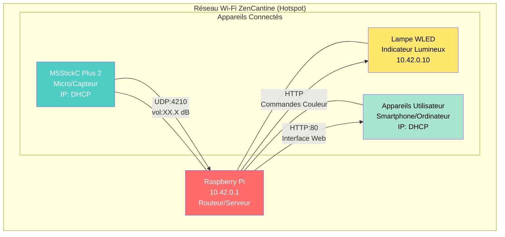

# 🤫 ZenCantine

> 📖 **Documentation available in:** [English](README.en.md) | [Français](README.md)

Système autonome de surveillance du niveau sonore pour cantine scolaire.
Le système affiche une alerte lumineuse (Lampe WLED) et visuelle (M5Stick) lorsque le bruit dépasse un seuil défini.

## 📡 Architecture Réseau

Le Raspberry Pi agit comme routeur Wi-Fi autonome (Hotspot).

| Appareil | Rôle | IP (Fixe) | MAC Address |
|---|---|---|---|
| **Raspberry Pi** | Serveur / Routeur | `10.42.0.1` | N/A |
| **M5StickC Plus 2** | Micro / Capteur | DHCP | - |
| **Lampe WLED** | Indicateur Lumineux | `10.42.0.10` (par défaut) | `A CONFIGURER DANS WLED` |

* **SSID Wi-Fi :** à définir dans `sensor_m5stick/config/config.h`
* **Mot de passe :** à définir dans `sensor_m5stick/config/config.h`

**Légende :**
- 🔴 **Raspberry Pi** : Routeur Wi-Fi, serveur Flask, base de données SQLite
- 🔵 **M5StickC Plus 2** : Capteur audio, envoi mesures UDP
- 🟡 **Lampe WLED** : Indicateur lumineux contrôlé via HTTP
- 🟢 **Appareils Utilisateur** : Accès à l'interface web de configuration

> 💡 **Astuce :** Au lieu d'utiliser l'IP `10.42.0.1`, vous pouvez accéder au Raspberry Pi via son hostname : `http://raspberrypi.local` (ou le hostname que vous avez configuré). Cela fonctionne sur la plupart des réseaux locaux avec mDNS.

## 🚀 Installation & Démarrage

Le système est conçu pour démarrer automatiquement à la mise sous tension.

### 1. Raspberry Pi (Server)
Le script principal est `server_raspberry/app.py`.
Il écoute les paquets UDP du M5Stick sur `10.42.0.1:4210`, stocke les mesures dans SQLite et pilote une lampe WLED via HTTP.

> UDP est utilisé uniquement pour la transmission du volume du capteur M5Stick vers le serveur.
> Le pilotage de la lampe WLED se fait par requêtes HTTP.

### 2. M5Stick (Micro)
Le code Arduino utilise la librairie `M5Unified` et envoie le volume via UDP sur le port `4210`.
Le niveau sonore est maintenant mesuré en **dB SPL** (Sound Pressure Level).

### 3. Lampe WLED
La lampe doit être accessible depuis le hotspot du Raspberry Pi, idéalement avec une IP statique ou une réservation DHCP.

## 🧩 Mode serveur

Ce dépôt contient un seul serveur actif :

- `server_raspberry/app.py` : version Flask + dashboard, stocke les mesures dans SQLite et pilote une lampe WLED via `server_raspberry/config/config.py`.

## 🌐 Interface Web

Le serveur Flask fournit une interface web complète accessible sur l'IP du Raspberry Pi (port 80).

### Fonctionnalités :
- **Dashboard temps réel** : Affichage du volume actuel, état d'alerte, statistiques journalières
- **Configuration avancée** : Réglage des seuils sonores (alerte/reset), taille du buffer de lissage
- **Gestion du temps** : Ajustement manuel de l'heure système pour systèmes hors ligne
- **Visualisation des données** : Graphiques d'historique sur 1 heure ou 24 heures
- **Administration** : Reset aux valeurs par défaut, sauvegarde automatique des paramètres

### Accès :
- URL : `http://10.42.0.1` ou `http://raspberrypi.local` (ou l'IP/hostname de votre Raspberry Pi)
- Accessible depuis n'importe quel appareil connecté au hotspot Wi-Fi

### API REST :
- `/api/now` : Données temps réel
- `/api/stats` : Statistiques du jour
- `/api/history` : Historique des mesures
- `/api/config` : Gestion de la configuration
- `/api/time` : Réglage de l'heure
